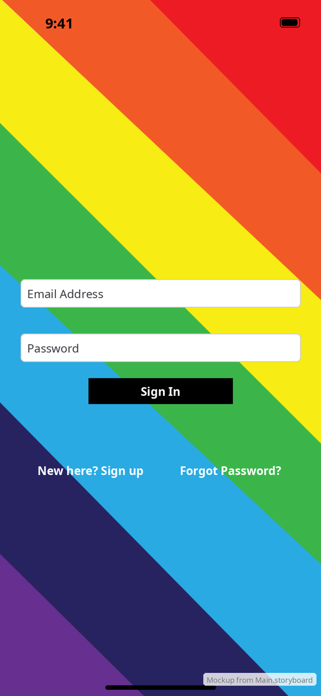
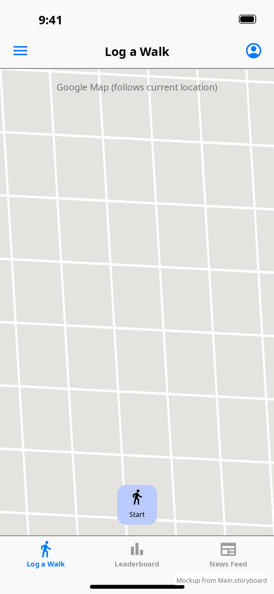
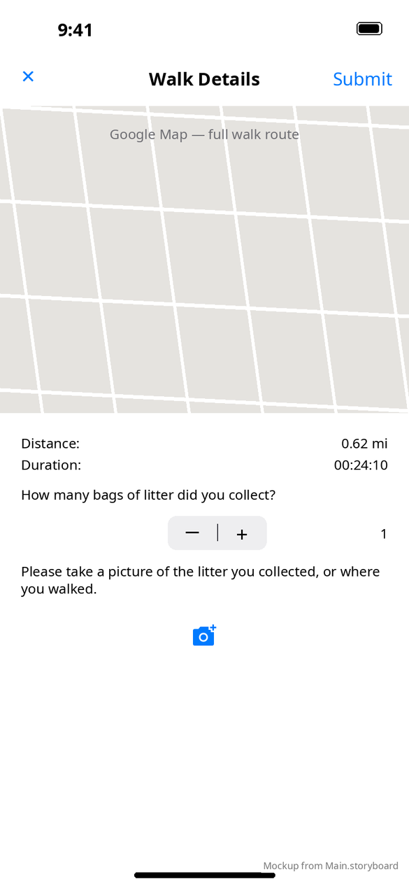
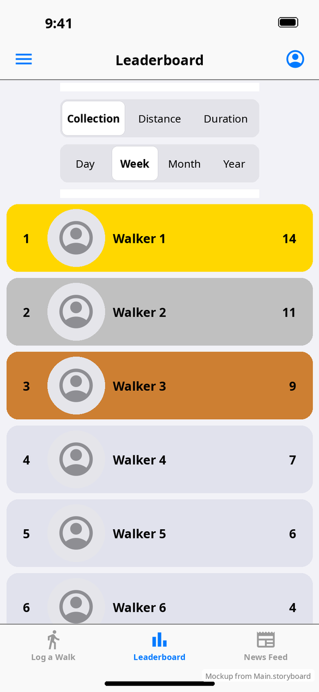
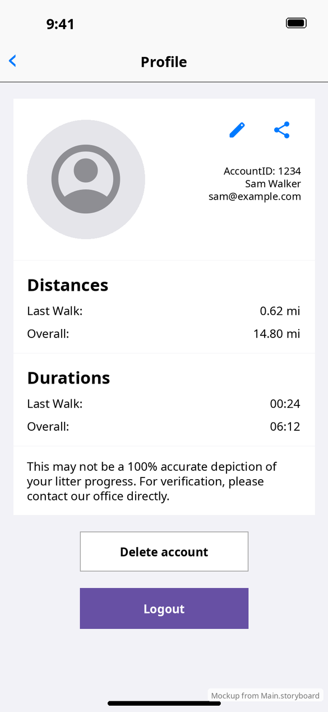
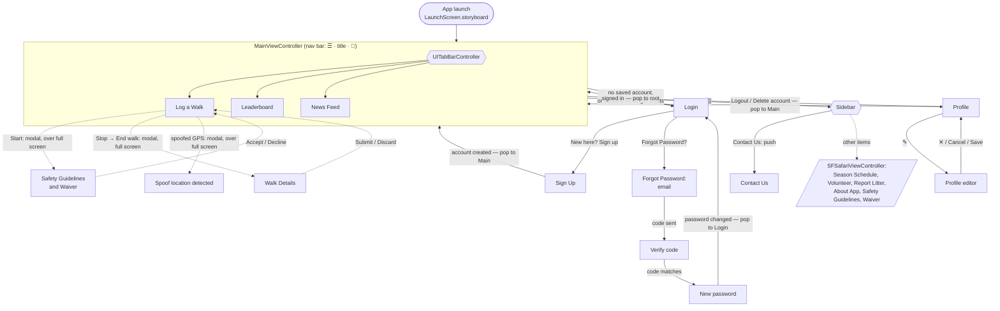
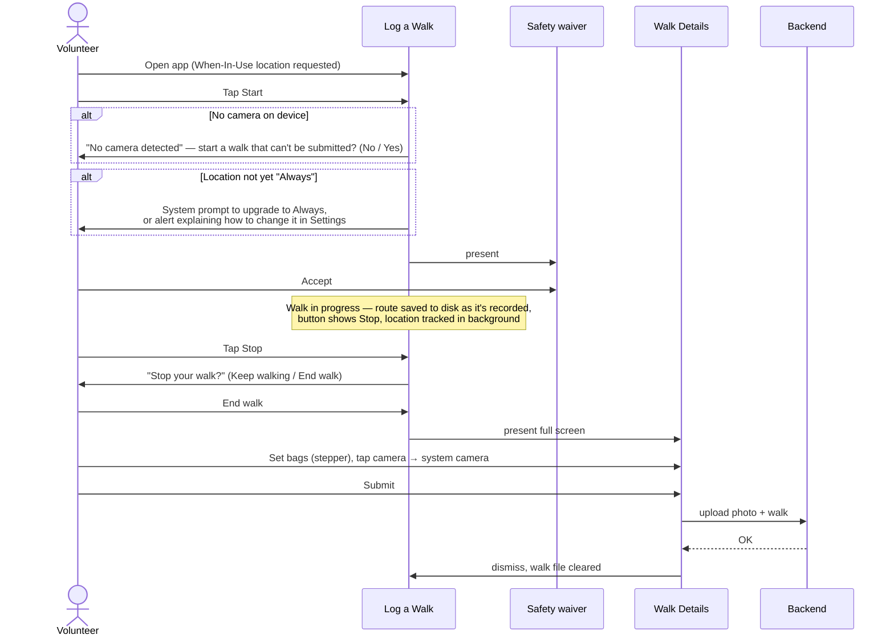

# iOS App — Frontend Design

This folder documents how the Walking For Rochester iOS app looks and how the user moves between screens. It mirrors the [Android design docs](../../../MobileApplication/docs/design/README.md) (in the `MobileApplication` repo), and each page notes where iOS differs from Android.

- **UI toolkit:** UIKit, Objective-C. Almost all layout is in `Walking For Rochester/Base.lproj/Main.storyboard`, with Google Maps via CocoaPods.
- **App version documented:** 2.0.1 (build 11). Deployment target iOS 15. iPhone and iPad.
- **Appearance:** light mode only (`UIUserInterfaceStyle = Light`).

> **About the images:** these are **mockups rendered from `Main.storyboard`**, not simulator screenshots. They were made without a Mac, by drawing each storyboard scene's views at their design-time positions with a generic sans-serif font. Colors, text, controls and layout come from the storyboard. Where the app fills in content in code (names, stats, routes), sample values are shown. Google Maps and the web view are drawn as placeholders. Each image is stamped "Mockup from Main.storyboard". Expect small differences from a real device in fonts, spacing and system controls.

## Contents

| Page | What it covers |
|---|---|
| [App shell & navigation](screens/app-shell.md) | Navigation bar, tab bar, slide-out sidebar, how screens are stacked |
| [Login](screens/login.md) | Email/password sign-in |
| [Sign up](screens/sign-up.md) | Registration form and validation |
| [Forgot password](screens/forgot-password.md) | Request code → verify code → new password |
| [Log a Walk](screens/log-walk.md) | Home tab: map, Start/Stop, location permission, safety waiver, spoof detection |
| [Walk Details (finish walk)](screens/finish-walk.md) | Summary, bags of litter, photo, submit or discard |
| [Leaderboard](screens/leaderboard.md) | Rankings by collection, distance or duration, per period |
| [News Feed](screens/news-feed.md) | Embedded WordPress news page |
| [Profile](screens/profile.md) | Stats, edit profile, share, logout, delete account |
| [Contact Us & web links](screens/contact-and-links.md) | Contact screen and sidebar links |
| [Shared components](components.md) | Field views, round images, busy overlay, alerts |
| [Theme](theme.md) | Color assets, system colors, fonts, icons |

## At a glance

## Screen map

The window's root is `RootViewController`, which holds the sidebar and embeds a `UINavigationController`. That navigation controller's root is `MainViewController`, which embeds the tab bar controller. Everything else is pushed onto that one navigation stack or presented modally on top of it.

Solid arrows are pushes and pops on the main navigation stack. Dotted arrows are modal presentations. Login is pushed with its navigation bar hidden. After logout, `MainViewController.viewWillAppear` sees there's no account and pushes Login again.

### Which chrome each screen shows

| Screen | Nav bar | Left | Right | Tab bar |
|---|---|---|---|---|
| Log a Walk / Leaderboard / News Feed | ✓ (title = selected tab) | ☰ sidebar | 👤 profile | ✓ |
| Login | hidden | — | — | — |
| Sign Up, Forgot Password (all steps), Contact Us | ✓ | ‹ back | — | — |
| Profile | ✓ | ‹ back | — | — |
| Profile editor | ✓ | ✕ cancel | — | — |
| Walk Details | own bar in the view | ✕ discard | Submit | — |
| Safety waiver, Spoof detected | card over dimmed screen | — | — | (visible behind) |

## Main task: logging a walk

## iOS vs Android at a glance

| Area | iOS | Android |
|---|---|---|
| Sign-in options | Email + password only | Email/password, Google, Facebook, saved-password autofill |
| Dark mode | Not supported (forced light) | In-app toggle in the drawer |
| Main navigation | Tab bar + slide-out sidebar (custom, swipe to close) | Bottom navigation bar + Material navigation drawer |
| Starting a walk | Requires **Always** location. Warns if the device has no camera. | Asks for notification permission (Android 13+), then the waiver |
| Walk storage | Route written to a file while walking. An unfinished walk reopens Walk Details on next launch. | Kept in memory (can be lost on reboot) |
| Walk photo | System camera (`UIImagePickerController`), with a **Retake** button | Custom in-app CameraX screen with capture/confirm |
| Bags of litter | `UIStepper` (0–15) | ◀ value ▶ number picker |
| Delete account | Alert with a text field: type "YES" | Dialog with a text field: type "YES" |
| Sharing profile | Text-only share sheet | Share sheet with logo image and text |
| Offline | No global overlay. Errors appear as alerts, and walks can still be logged offline. | Full-screen "no connection" overlay |
| Contact Us | Shows build number too ("2.0.1 (build 11)") | Version only |

## How the mockups were made

A scratch Python script (not checked in) parsed `Main.storyboard` with `xml.etree`, walked each scene's view tree using `<rect key="frame">`, and drew labels, buttons (including `buttonConfiguration` and attributed titles), text fields, switches, steppers, segmented controls and image views. Icons came from `Assets.xcassets` (SVGs rasterised with cairosvg) and colors from the `.colorset` files. A simulated status bar, navigation bar and tab bar were added from each scene's navigation items. Validation labels (red text) were hidden except in the "errors" variant. Rendering was at 2× and the saved images are 1.5×. To replace these with real screenshots, capture on an iPhone 15/16-size simulator (390×844 pt) and keep the same filenames in `images/`.
