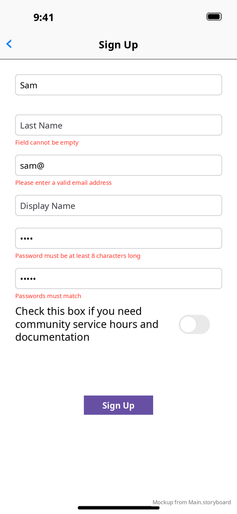

# Shared components

[← Design index](README.md) · `Walking For Rochester/`

## SignUpFieldView — `SignUpFieldView.{h,m}`

The standard form field used on Login, Sign Up, Forgot Password and the Profile editor. It is a rounded-rect `UITextField` (14 pt) with a red 10 pt **validation label** underneath.

- `validate` / `validateAll` check this field and every field chained after it, and show the first error for each.
- `setErrorText:isTemporary:` shows a server-side message, such as "Email already registered". A temporary message clears on the next edit.
- Fields are chained: Return moves to the next field (return key **Next**), and the last field shows **Done**.

## Buttons

Configured in the storyboard rather than through a shared class:

| Style | Used for | Look |
|---|---|---|
| Primary | Sign Up, Request code, Verify code, Change password, Save, Logout, Choose new photo | Purple fill `#674FA4` (rgb 0.404, 0.314, 0.643), white bold 13–14 pt text |
| Black | Sign In (on the rainbow background) | Black fill, white bold 14 pt |
| Outlined | Delete account, Cancel | White fill, gray (0.667) border |
| Link | Sign up / Forgot Password? (Login), View Safety Guidelines / View Waiver, phone/email | Plain text. Links use `linkColor` and are underlined on Contact Us. |
| Start/Stop | Log a Walk | 56×56 pt, `color_walk_start_button`, 12 pt corners, icon above a 10 pt title |

## RoundImageView — `RoundImageView.m`

A `UIImageView` with corner radius set to half its width. Used for profile photos: 140 pt on Profile, 200 pt in the editor, 70 pt on leaderboard entries. Images load through `ImageLoader` / `NSCache+Extensions`.

## Table cells

| Cell | Screen | Content |
|---|---|---|
| `SidebarTableViewCell` | Sidebar | 24 pt icon + name |
| `LeaderboardParametersTableViewCell` | Leaderboard | Two segmented controls (type, period) |
| `LeaderboardEntryTableViewCell` | Leaderboard | Rank, round photo, name, value on a rank-colored card |
| `ProfileUserTableViewCell` | Profile | Photo, edit/share buttons, account ID/name/email |
| `ProfileStatisticsTableViewCell` | Profile | Title (Distances/Durations), Last Walk, Overall. Also holds the shared distance and duration formatters. |
| `ProfileAccountTableViewCell` | Profile | Delete account + Logout buttons |

## Modal cards

`SafetyAndGuidelinesWaiverViewController` and `SpoofDetectedViewController` are storyboard scenes presented `overFullScreen`. Each is a translucent black mask (a full-screen button) behind a white 350 pt card containing an icon, a 25 pt title, a body and text buttons. See [Log a Walk](screens/log-walk.md#modal-cards-and-alerts).

## Busy overlay — `BusyView.xib`, `WaitToken`

A window-level overlay shown while network calls run. Calls take a `WaitToken`. While at least one token is alive, `BusyView` covers the window; its dimming mask only appears after 0.25 s, so fast calls don't flash.

## Alerts

Standard `UIAlertController` alerts:

- **Error** (`APIManager`): "<error description> Please check your connection and try again." or "An error occurred. Please check your Internet connection and try again." (OK)
- The screen-specific alerts are listed on [Log a Walk](screens/log-walk.md), [Walk Details](screens/finish-walk.md) and [Profile](screens/profile.md).

**vs Android:** Android has shared Compose components (`WFRButton`, `WFRTextField`, `WFRDialog`, permission rationale dialogs). See [Android components](../../../MobileApplication/docs/design/components.md).
