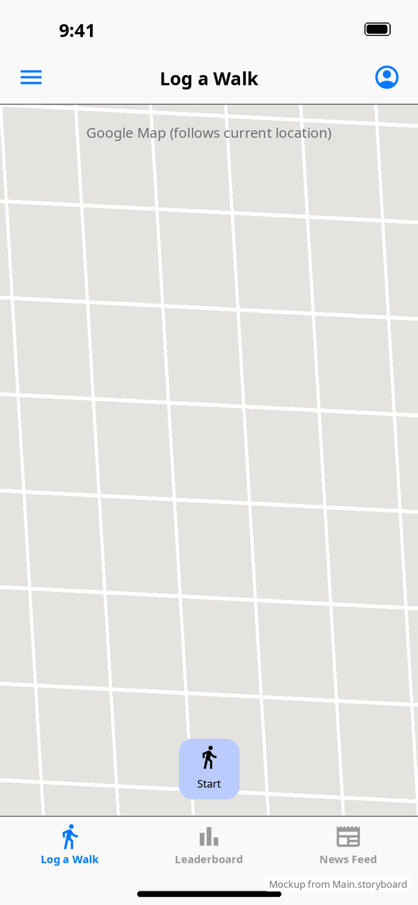
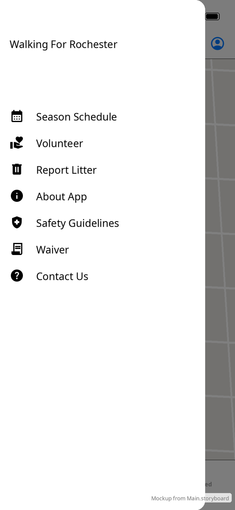

# App shell & navigation

[← Design index](../README.md) · `RootViewController`, `MainViewController`, `SidebarTableViewCell`, `TouchForwardingTableView`

## Structure

| Layer | Class | Role |
|---|---|---|
| Window root | `RootViewController` | Holds the slide-out sidebar and embeds the main `UINavigationController` |
| Navigation root | `MainViewController` | Nav bar with ☰ / title / 👤. Embeds the tab bar controller. Pushes Login when nobody is signed in. |
| Tabs | `UITabBarController` | **Log a Walk** (selected at launch), **Leaderboard**, **News Feed** |

The nav bar title is a custom title view that shows the selected tab's name. The tab bar is opaque before iOS 26 and translucent on iOS 26+.

## Sidebar

Opened with ☰. It is a custom panel, not a system component: a white panel with rounded right corners, `min(screen width − 50, 400)` pt wide, over a 50% black mask. Its "Walking For Rochester" title lines up with the nav bar title. It opens in 0.2 s. Tapping the mask closes it, and dragging it left closes it if it ends up less than ⅔ visible.

| Item | Icon asset | Opens |
|---|---|---|
| Season Schedule | `image_season_schedule` | SFSafariViewController → walkingforrochester.org/all-litter-events |
| Volunteer | `image_volunteer` | SFSafariViewController → volunteer form |
| Report Litter | `image_trash` | SFSafariViewController → Survey123 report |
| About App | `image_info` | SFSafariViewController → about-_the_app |
| Safety Guidelines | `image_health_and_safety` | SFSafariViewController → guidelines PDF |
| Waiver | `image_contract` | SFSafariViewController → waiver form |
| Contact Us | `image_help` | Pushes [Contact Us](contact-and-links.md) |

Rows are built in code (`RootViewController` + `SidebarTableViewCell`), so the sidebar mockup is drawn from that code, not from the storyboard.

## Login gating

Every time `MainViewController` appears, it checks for a saved account ID:

- **None:** pushes [Login](login.md).
- **Saved, but the server says the account doesn't exist:** clears it and pushes Login.
- **Network error:** keeps the saved account and fails silently, so walks can be logged without signal.

**vs Android:** Android uses a Material bottom navigation bar and navigation drawer with a dark-mode switch. iOS has no dark-mode switch, and swipe-to-open isn't supported, only swipe-to-close. See [Android app shell](../../../../MobileApplication/docs/design/screens/app-shell.md).
