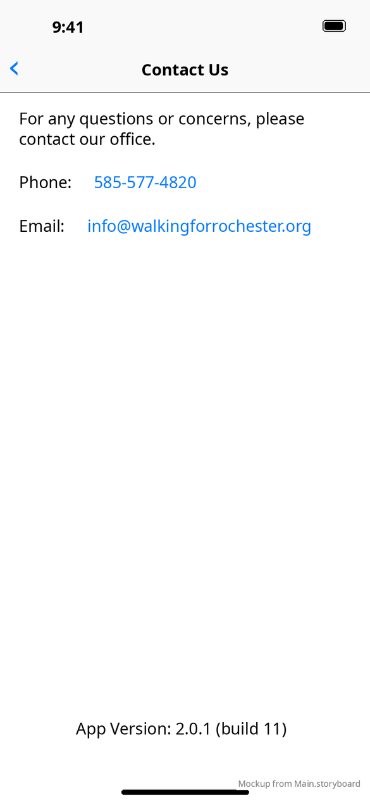

# Contact Us & web links

[← Design index](../README.md) · `ContactUsViewController`, `RootViewController`

Pushed from the sidebar, with title **Contact Us** and a back button.

- Text: "For any questions or concerns, please contact our office."
- **Phone:** 585-577-4820, an underlined link that opens `tel:`
- **Email:** info@walkingforrochester.org, an underlined link that opens `mailto:`
- Version label at the bottom: "App Version: 2.0.1 (build 11)"

## Web links

The other sidebar items, and the two links on the Safety waiver card, open in an in-app `SFSafariViewController`. See the table in [App shell](app-shell.md#sidebar). The URLs are hard-coded in `RootViewController.m` and `SafetyAndGuidelinesWaiverViewController.m`, and match the Android string resources.

**vs Android:** Android uses themed Chrome Custom Tabs. See [Android contact & links](../../../../MobileApplication/docs/design/screens/contact-and-links.md).
