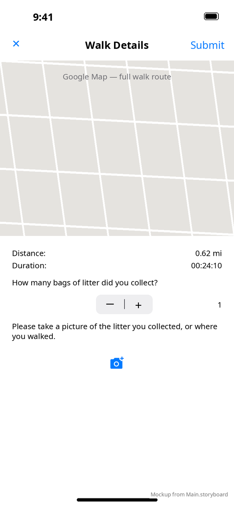

# Walk Details (finish walk)

[← Design index](../README.md) · `FinishWalkViewController` · presented **full screen** from Log a Walk

## Layout

1. Its own nav bar: **✕** (discard) · **Walk Details** · **Submit**
2. Route map (`GMSMapView`, top part of the screen) with the full path
3. **Distance** and **Duration**
4. "How many bags of litter did you collect?" with a `UIStepper` (0–15) and the count
5. "Please take a picture of the litter you collected, or where you walked." with a camera button (`image_camera`). Once a photo is taken, it replaces the prompt and a **Retake** button appears.

## Actions and alerts

| Action | Result |
|---|---|
| Camera button | System camera (`UIImagePickerController`). If camera access is denied: **Camera** alert ("…allow this permission in the Settings app", Cancel · Settings). With no camera: "Your device does not have a camera." |
| **Submit** without a photo | Alert: "A photo is required in order to submit your walk." (OK) |
| **Submit** with a photo | Uploads the image, then logs the walk (distance, duration, bags, encoded path), dismisses, and clears the saved walk |
| **✕** | **Discard walk**: "Are you sure you do not want to submit your walk?" (Cancel · Discard, destructive) |
| Walk upload fails | Standard **Error** alert. The walk is kept, so the user can tap Submit again. |
| Photo upload fails | **No message is shown** (`didUploadImageWithUrl:` ignores the error). The screen stays as it is. |

**vs Android:** the photo comes from the system camera rather than an in-app camera screen. A stepper replaces Android's number picker. See [Android Submit Walk](../../../../MobileApplication/docs/design/screens/submit-walk.md) and [Take Picture](../../../../MobileApplication/docs/design/screens/take-picture.md).
