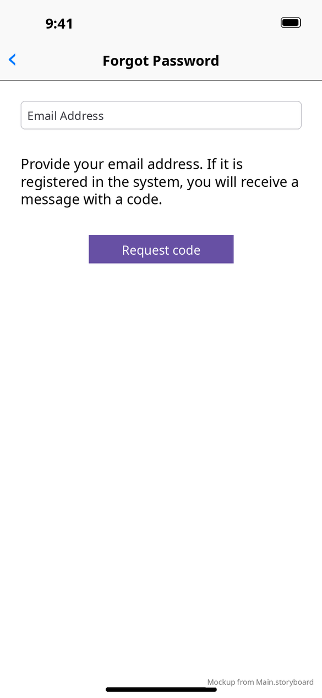
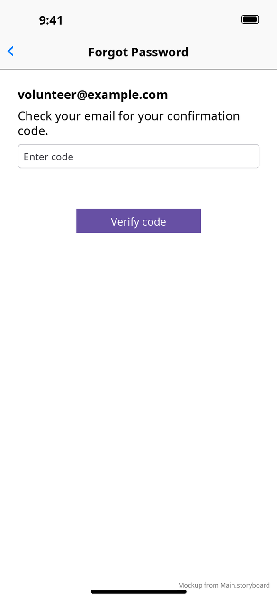
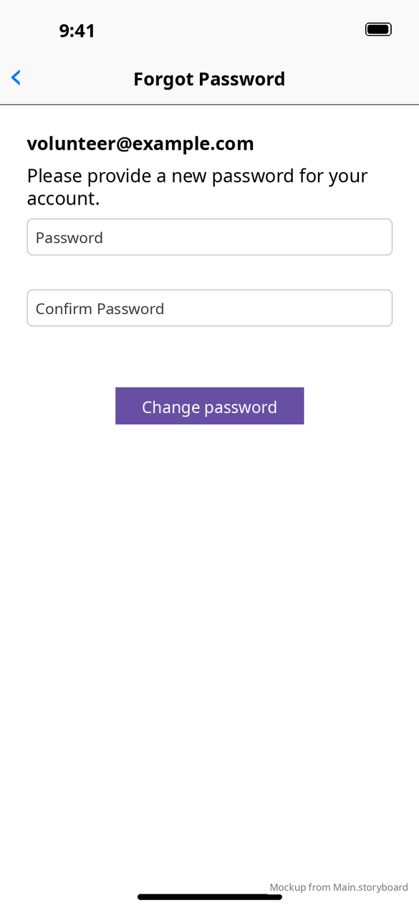
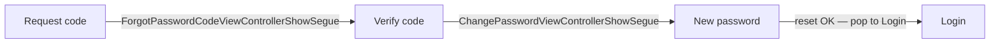

# Forgot password

[← Design index](../README.md) · `ForgotPasswordRootViewController` → `ForgotPasswordEmailViewController` → `ForgotPasswordCodeViewController` → `ChangePasswordViewController`

The root controller shows the **Forgot Password** nav bar and embeds its own navigation controller, which has a hidden bar. The steps are pushed inside that embedded controller, so the visible back button always returns to Login, whichever step you're on.

| 1. Request code | 2. Verify code | 3. New password |
|---|---|---|
|  |  |  |
| Email → **Request code** | Shows the email, then the code → **Verify code** ("The provided code does not match" on a mismatch) | Password + confirm → **Change password** |

**vs Android:** the same three steps. Android swaps them in place on one screen, while iOS pushes them. See [Android forgot password](../../../../MobileApplication/docs/design/screens/forgot-password.md).
