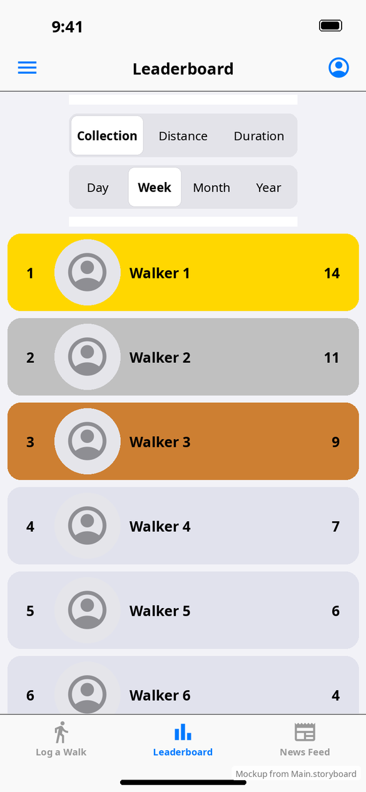

# Leaderboard

[← Design index](../README.md) · `LeaderboardViewController`, `LeaderboardParametersTableViewCell`, `LeaderboardEntryTableViewCell`

A table view. The first row holds two segmented controls (15 pt medium text):

- **Collection · Distance · Duration** (default Collection)
- **Day · Week · Month · Year** (default Week)

The other rows are entry cards (82 pt tall). Each shows the rank, a round 70 pt profile photo (`RoundImageView`), the name and the value. Card background depends on rank:

| Rank | Color asset | Hex |
|---|---|---|
| 1 | `color_leaderboard_rank_0` | #FFD700 gold |
| 2 | `color_leaderboard_rank_1` | #C0C0C0 silver |
| 3 | `color_leaderboard_rank_2` | #CD7F32 bronze |
| 4+ | `color_leaderboard_rank_3+` | #E1E2ED |

Changing either control reloads the list. The names and values in the mockup are sample data.

**vs Android:** the same filters, defaults and medal colors. See [Android leaderboard](../../../../MobileApplication/docs/design/screens/leaderboard.md).
