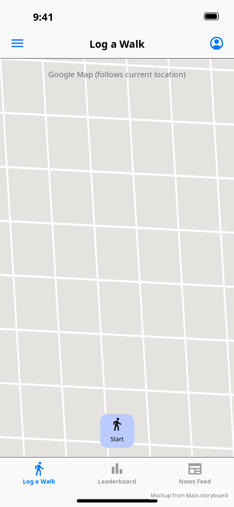
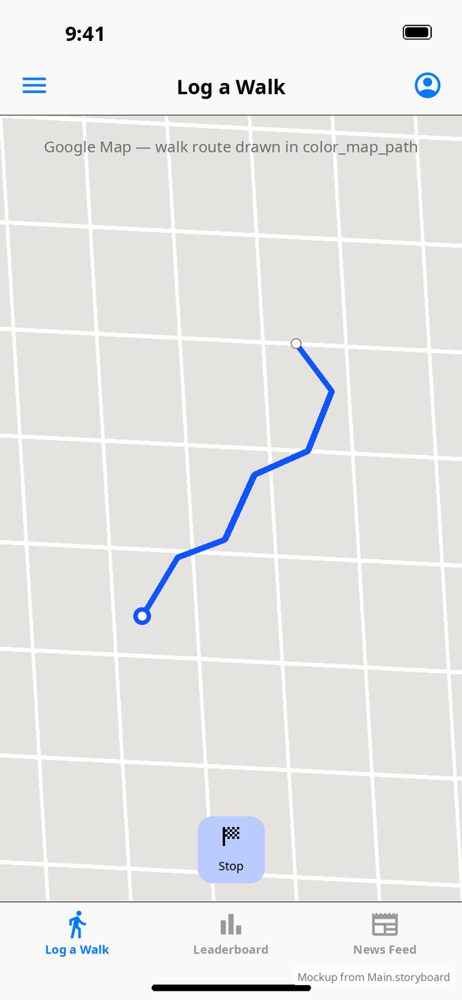
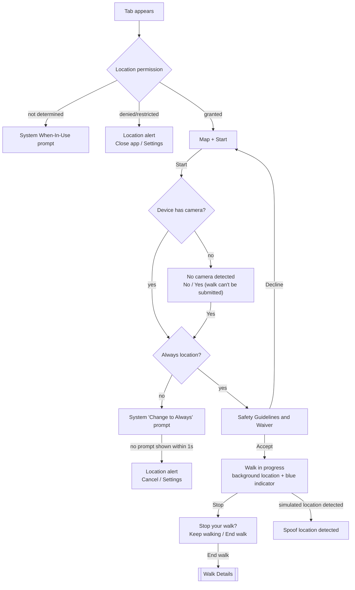
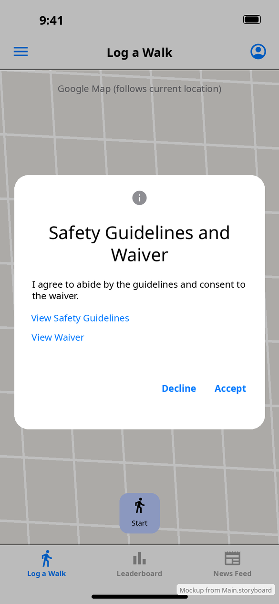
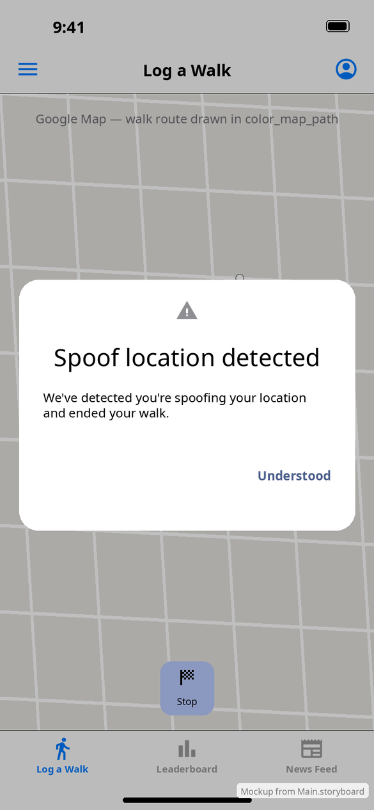

# Log a Walk (home tab)

[← Design index](../README.md) · `LogWalkViewController` · `Walk` (on-disk route), `SafetyAndGuidelinesWaiverViewController`, `SpoofDetectedViewController`

| Idle | Walking |
|---|---|
|  |  |

A full-screen Google Map (`GMSMapView`) follows the user. **All map gestures are turned off**, so the camera always tracks the current location. While walking, the route is drawn in `color_map_path` (#0E54FF) with start and end markers (`image_trip_origin`, `image_trip_destination`). The map is a placeholder in the mockups.

The 56×56 pt **Start/Stop** button sits at the bottom center: `color_walk_start_button` (#B9CBFF) with 12 pt corners. It shows a walking icon and "Start" when idle, and a checkered flag and "Stop" while walking.

## Starting a walk

## Modal cards and alerts

| Safety Guidelines and Waiver | Spoof location detected |
|---|---|
|  |  |
| Custom card over a dimmed screen (`overFullScreen`). The **View Safety Guidelines** and **View Waiver** links open SFSafariViewController. Tapping outside the card counts as **Decline**. | Shown when a location reading during a walk isn't from the phone's own GPS, meaning it is simulated by software or produced by an external accessory (`Walk.m`). **Understood** dismisses it, and the walk is ended and cleared. |

System alerts on this screen (text from `LogWalkViewController.m`):

| Title | Message (abridged) | Buttons |
|---|---|---|
| Location | "…uses your precise location to display your position and current route… allow this permission in the Settings app." | Close app · Settings |
| Location | "When you are on an active walk… records your progress even when the app is not in use… change 'Share My Location' to 'Always'…" | Cancel · Settings |
| No camera detected | "A camera is required to submit a walk. Do you want to start a walk that you will not be able to submit for credit?" | No · Yes |
| Stop your walk? | "Are you sure you want to end your walk and start the submission process?" | Keep walking · End walk |

## Persistence

The walk is written to a file as it's recorded. If the app is relaunched mid-walk, the route and start marker are restored. If a walk was ended but not submitted, **Walk Details** reopens automatically.

**vs Android:** iOS needs **Always** location and has no notification-permission step. The safety and spoof dialogs are custom cards rather than Material dialogs. Map panning is turned off on iOS. See [Android Log a Walk](../../../../MobileApplication/docs/design/screens/log-a-walk.md).
