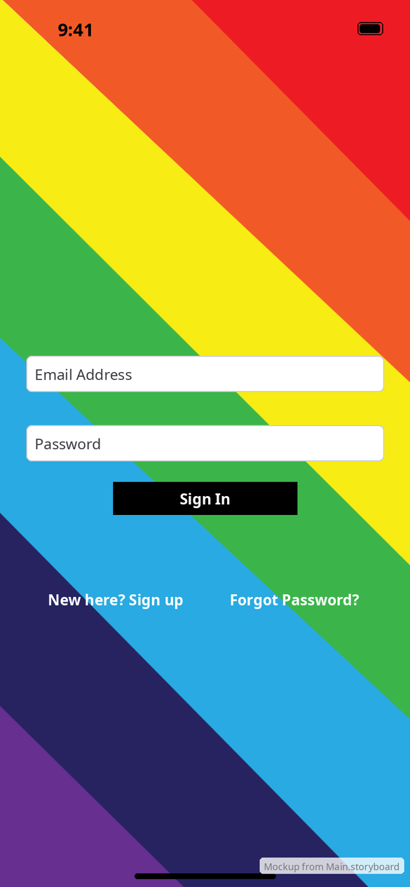

# Login

[← Design index](../README.md) · `LoginViewController`

Pushed by `MainViewController` when nobody is signed in, with the navigation bar hidden. The background is the full-screen rainbow image (`image_rainbow_bg`).

## Elements

- **Email Address** and **Password** fields (`SignUpFieldView`, rounded-rect text fields). Validation messages appear in red under the field. A wrong email or password shows the server's error text under the password field.
- **Sign In:** black button, white bold 14 pt text
- **New here? Sign up** → [Sign up](sign-up.md) (push)
- **Forgot Password?** → [Forgot password](forgot-password.md) (push)

## Behavior

- On success the stack pops back to `MainViewController`, showing the Log a Walk tab.
- Network or server errors show the standard **Error** alert (see [components](../components.md#alerts)).

**vs Android:** no Google or Facebook buttons (Apple would then require Sign in with Apple), no "or" divider, and no password-manager autofill prompt. See [Android login](../../../../MobileApplication/docs/design/screens/login.md).
