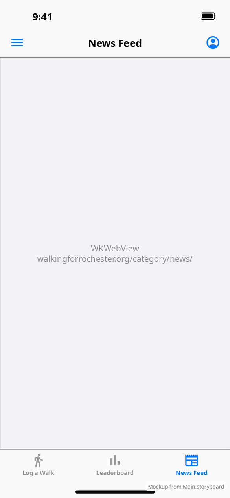

# News Feed

[← Design index](../README.md) · `NewsFeedViewController`

A `WKWebView` that loads `https://walkingforrochester.org/category/news/` between the nav bar and the tab bar. All content and styling come from the WordPress site.

**vs Android:** identical in concept. See [Android news feed](../../../../MobileApplication/docs/design/screens/news-feed.md).
