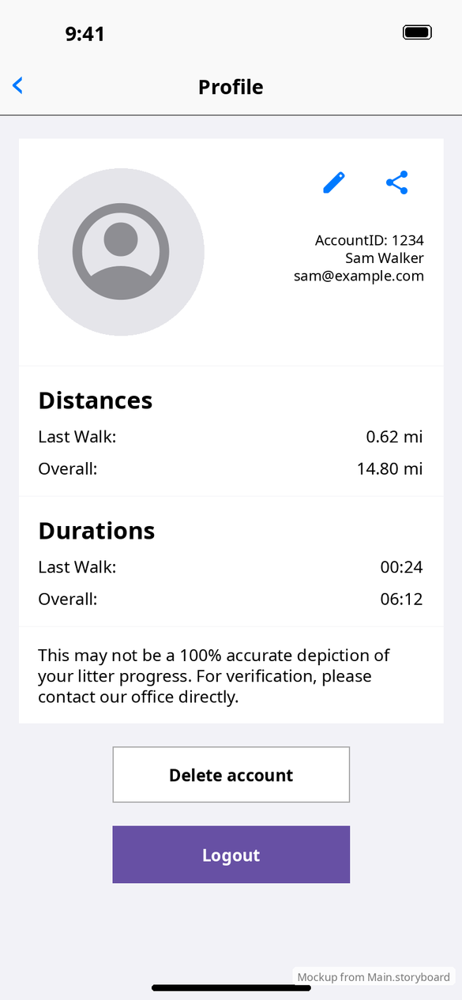
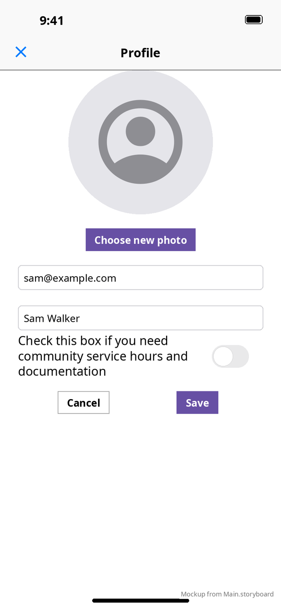

# Profile

[← Design index](../README.md) · `ProfileRootViewController` → `ProfileViewController` → `ProfileEditorViewController`

Pushed from the 👤 button. The root controller shows the **Profile** nav bar and embeds a navigation controller with a hidden bar. The editor is pushed inside that.

| Profile | Editor |
|---|---|
|  |  |

## Profile (inset grouped table)

1. **User cell:** a 140 pt round photo, **✎ edit** and **share** buttons, account ID, name and email
2. **Distances** and **Durations** cells: Last Walk and Overall
3. Disclaimer: "This may not be a 100% accurate depiction of your litter progress…"
4. **Delete account** (outlined) and **Logout** (filled purple)

The mockup's name, email and numbers are sample data.

- **Share** opens the system share sheet with text: "Check out my stats with Walking For Rochester! Distance, last walk… Duration, last walk…"
- **Delete account** shows an alert: "Sorry to see you go. By continuing, your account and all walk history will be deleted…" It has a text field ("Type "YES" to confirm"), and the destructive **Delete account** button stays disabled until "YES" is typed.
- **Logout** and successful deletion clear the account and pop to Main, which shows Login.

## Editor

A 200 pt round photo with **Choose new photo** (`PHPickerViewController`, images only), Email Address, Display Name, the community service switch, and **Cancel** / **Save**. The nav bar's left button becomes **✕**, which also cancels.

**vs Android:** the same content. Android's share sheet includes the logo image, and Android shows the delete confirmation as a Material dialog. See [Android profile](../../../../MobileApplication/docs/design/screens/profile.md).
