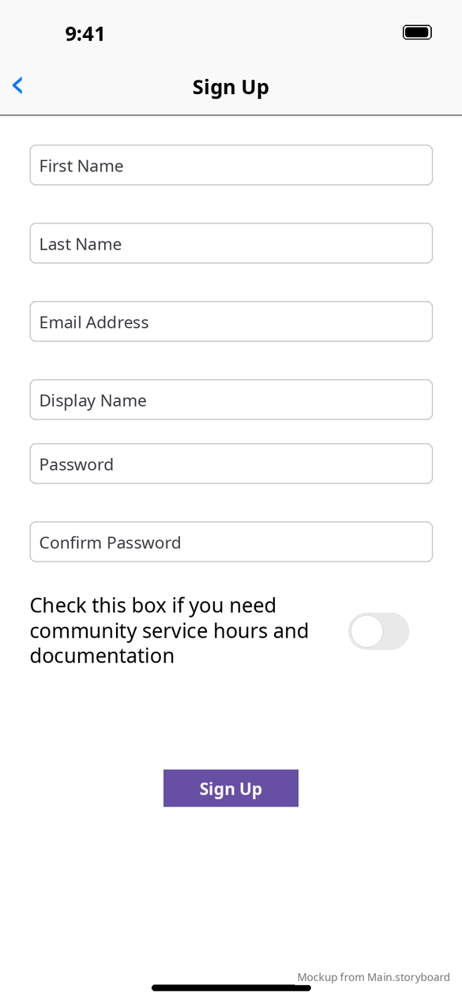
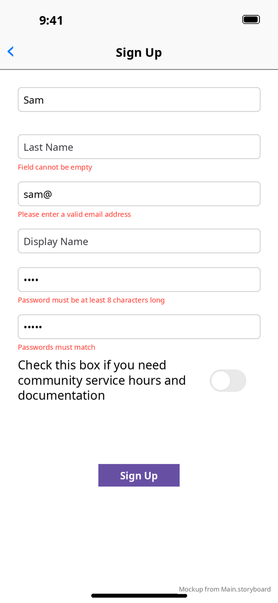

# Sign up

[← Design index](../README.md) · `SignUpViewController` · title **Sign Up**, back button

| Empty | Validation errors |
|---|---|
|  |  |

## Fields

First Name, Last Name, Email Address, Display Name (optional), Password, Confirm Password, and the **community service** switch ("Check this box if you need community service hours and documentation"). The purple **Sign Up** button is below.

Validation messages (red, 10 pt) appear under the field that fails:

| Field | Message |
|---|---|
| First / Last Name | Field cannot be empty |
| Email Address | Please enter a valid email address · Email already registered |
| Password | Password must be at least 8 characters long |
| Confirm Password | Passwords must match |

## Behavior

1. Validates all fields.
2. Checks whether the email is already registered. If it is, "Email already registered" appears briefly under the email field.
3. Creates the account and pops back to `MainViewController`, now signed in.

**vs Android:** the same fields and rules. Android uses a checkbox where iOS uses a switch, and Android can prefill fields from Google/Facebook. See [Android registration](../../../../MobileApplication/docs/design/screens/registration.md).
